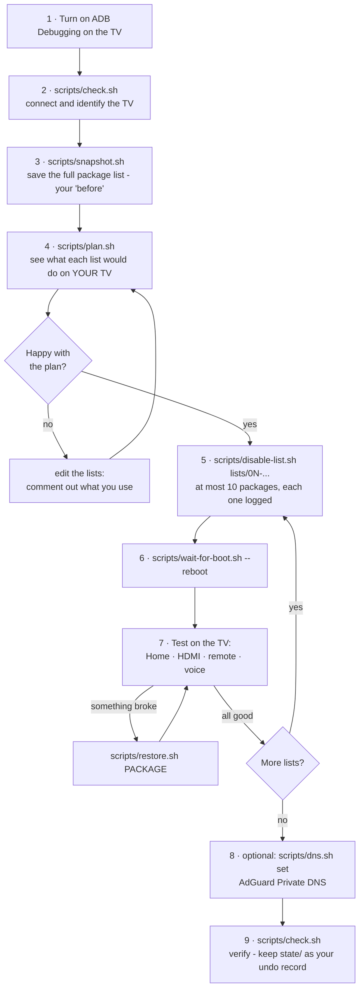
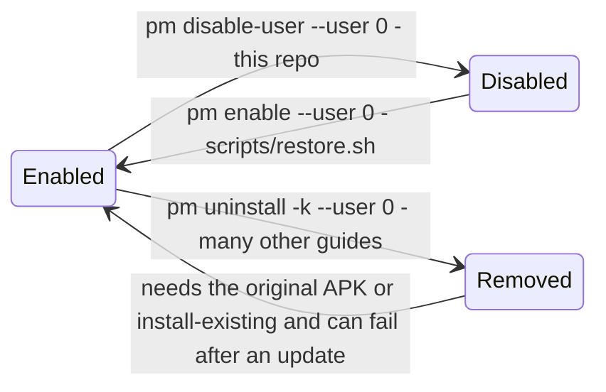
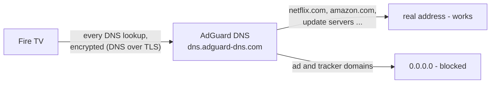

<h1 align="center">📺 Fire TV Detox</h1>

<p align="center"><b>Debloat a Fire OS smart TV over ADB — safely, reversibly, one small batch at a time.</b></p>

<p align="center">
  
  
  
  
  
</p>

A Fire OS TV ships with roughly **275 packages**. Dozens of them are ad services, trackers, telemetry uploaders, tutorials, demo-mode content and shopping apps that sit in memory on a TV with 1.8 GB of RAM. This repo turns the junk **off** — never uninstalled — in batches of ten, with a reboot and a four-point test between batches, logging every change so any of it can be undone with one command.

> [!NOTE]
> **Reference run:** a TCL Fire TV (model `AFTDEC012E`, Fire OS 8.1.8.5 / Android 11). **43 packages disabled**, 4 refused by Fire OS, 2 quietly turned back on by Fire OS at reboot. Home screen, HDMI inputs, remote and Alexa voice all kept working. Ads and trackers blocked with AdGuard Private DNS while Amazon's update servers stay reachable. Full log in [`docs/reference-run-tcl-fire-os-8.md`](docs/reference-run-tcl-fire-os-8.md).

---

## Contents

- [What you get](#what-you-get)
- [Does this apply to my TV?](#does-this-apply-to-my-tv)
- [What you need](#what-you-need)
- [Quick start](#quick-start)
- [Let Claude Code do it](#let-claude-code-do-it)
- [How it works](#how-it-works)
- [Step by step](#step-by-step)
- [The lists](#the-lists)
- [Thin out the stock home screen](#thin-out-the-stock-home-screen-no-adb-needed)
- [Optional: an apps-only home screen](#optional-an-apps-only-home-screen)
- [Optional: block ads and trackers](#optional-block-ads-and-trackers-adguard-private-dns)
- [Undo](#undo)
- [After a Fire OS update](#after-a-fire-os-update)
- [Things that look like a good idea but aren't](#things-that-look-like-a-good-idea-but-arent)
- [Troubleshooting](#troubleshooting)
- [FAQ](#faq)
- [Repo layout](#repo-layout)
- [Contributing](#contributing)
- [Disclaimer and license](#disclaimer-and-license)

---

## What you get

| | |
|---|---|
| **Safer** | Only `pm disable-user --user 0`. Nothing is uninstalled, nothing is written to `/system`. A guard list (`lists/never-touch.txt`) makes the scripts *refuse* to touch the launcher, Settings, keyboard, Appstore, Prime Video, HDMI/tuner, remote, Bluetooth, Alexa, updates and every AOSP component. |
| **Reversible** | Every disabled package is logged in `state/disabled.txt`. `scripts/restore.sh --all` puts everything back. A factory reset also restores everything, because nothing was removed. |
| **Methodical** | At most 10 packages per batch, then reboot, then you test **Home → HDMI → remote → voice** before the next batch. When something breaks you know which ten to suspect. |
| **Honest** | The lists say what each package does and what you lose. The write-up says what *didn't* help (custom launchers, animation tweaks, task killers) and why. |
| **Automatable** | [`CLAUDE.md`](CLAUDE.md) lets [Claude Code](https://claude.com/claude-code) run the whole procedure for you under the same rules. |

**What changes after the detox:** the home screen and Settings feel snappier, less memory is swapped out, and ad/tracker domains stop resolving. **What doesn't change:** how long Netflix, Prime Video or Disney+ take from their logo to your profile — that's the app talking to its own servers, and no TV-side tweak fixes it.

---

## Does this apply to my TV?

| Your TV | Use this? |
|---|---|
| **Fire OS 8** — TCL, Hisense, Insignia, Toshiba, Amazon Omni / 2-, 4-Series, newer Fire TV Sticks and Cubes | **Yes.** The lists were verified on a Fire OS 8.1 TCL. Package names are the same across the Fire OS 8 family; `scripts/plan.sh` shows you exactly which ones are present on *your* TV. |
| **Fire OS 7** — older Fire TV Sticks, Cubes, Toshiba/Insignia Fire TV Editions | **Yes, with care.** Same method, mostly the same packages. Some packages that are "protected" on Fire OS 8 can be disabled here. Private DNS works (Android 9). |
| **Fire OS 6 and older** | The `pm disable-user` method works, but the lists only partly match and Private DNS does not exist (Android 7). Run `scripts/plan.sh` and read what it finds. |
| **Google TV / Android TV** (TCL, Sony, Hisense models that are *not* Fire TV) | **No — not these lists.** The ADB method is the same but the bloat is `com.google.*` and vendor packages. Don't run these lists on them. |
| Roku, LG webOS, Samsung Tizen | No. Not Android. |

How to tell: **Settings → My Fire TV → About** shows "Fire OS x.x.x.x". Or, once connected: `adb shell getprop ro.build.version.name`.

---

## What you need

1. **A computer on the same network as the TV** with `adb` (Android platform tools):
   - macOS: `brew install --cask android-platform-tools`
   - Windows: download [platform-tools](https://developer.android.com/tools/releases/platform-tools), unzip, add to PATH (run the scripts in Git Bash or WSL)
   - Debian/Ubuntu: `sudo apt install adb`
2. **The TV's IP address:** Settings → My Fire TV → About → Network.
3. **ADB Debugging switched on:** Settings → My Fire TV → Developer Options → **ADB Debugging → ON**.
   If *Developer Options* is missing: Settings → My Fire TV → About, highlight the first line (the TV's name) and press **Select** 7 times.
4. On the first connection the TV shows **"Allow USB debugging?"** — choose **Always allow**.

No root, no custom firmware, no apps installed on the TV.

---

## Quick start

```sh
git clone https://github.com/noumanasim232/fire-tv-detox.git
cd fire-tv-detox
cp tv.conf.example tv.conf        # put your TV's IP in it

scripts/check.sh                  # connects, shows model + Fire OS version
scripts/snapshot.sh               # saves the full package list - your "before"
scripts/plan.sh                   # shows what each list would do on YOUR TV

scripts/disable-list.sh lists/01-tracking-and-ads.txt
scripts/wait-for-boot.sh --reboot # then test: Home, HDMI, remote, voice
scripts/disable-list.sh lists/02-promos-and-tutorials.txt
scripts/wait-for-boot.sh --reboot # test again
scripts/disable-list.sh lists/03-amazon-extras.txt
scripts/wait-for-boot.sh --reboot # test again
scripts/disable-list.sh lists/04-diagnostics-and-misc.txt
scripts/wait-for-boot.sh --reboot # test again

scripts/dns.sh set                # optional: AdGuard Private DNS (ads + trackers)
scripts/check.sh                  # verify; state/ is your undo record
```

Every `disable-list.sh` run prints the packages, waits for you to type `yes`, and skips anything that isn't on your TV, is already off, or is protected.

---

## Let Claude Code do it

[`CLAUDE.md`](CLAUDE.md) contains the rules and the workflow in a form Claude Code follows. It will ask for your TV's IP, ask which apps you use, show you the categorised plan, wait for your yes, run the batches one package at a time, reboot, wait for the home screen, and ask you to test after each batch.

```sh
cd fire-tv-detox
claude
```
```text
> Read README.md and CLAUDE.md, then help me debloat my Fire TV at 192.168.1.xx.
> Show me the plan first and ask before each batch.
```

The rules in `CLAUDE.md` are the same guard rails the scripts enforce: disable only, never the never-touch list, batches of ten, reboot and test, no animation tweaks, no blocked update servers. If you paste a package list from a forum, Claude cross-checks it against the guard list instead of running it blindly.

---

## How it works



### Disable, not uninstall



`pm disable-user --user 0 <package>` marks the app disabled for the TV's main user. The APK stays on the system partition. It stops running, stops receiving broadcasts, and disappears from the launcher. `pm enable` brings it back in a second, with its data intact. Disabled apps still appear in **Settings → Applications → Manage Installed Applications** — with an *Enable* button instead of *Open*. That is expected.

`pm uninstall -k --user 0` (what most forum guides use) removes the app for the user. Getting it back needs `cmd package install-existing`, which does not always work after a Fire OS update. This repo never uses it.

### Why batches, why reboot

Some packages only matter at boot: HDMI handshake, remote pairing, Alexa services, the input list. A package that looks harmless while the TV is running can leave you with a black HDMI input after the next restart. Rebooting after each batch of ten surfaces that while you still know which ten to suspect. Fire OS also silently re-enables some packages at boot — you want to see that before building on it.

---

## Step by step

### 1. Connect and identify

```sh
cp tv.conf.example tv.conf   # TV=192.168.1.xx:5555
scripts/check.sh
```
```text
TV         192.168.1.xx:5555
Model      AFTDEC012E (Amazon)
Fire OS    Fire OS 8.1.8.5 (RS8185/3885)   Android 11
Uptime     0h 23m

Disabled on TV: 0   logged in state/disabled.txt: 0
  state/disabled.txt matches the TV.

Private DNS   mode=null  server=null
Animations    window=1.0  transition=1.0  animator=null
Memory        MemAvailable: 540 MB   SwapFree: 280 MB
```

### 2. Snapshot

```sh
scripts/snapshot.sh
```
Writes `state/snapshots/<date>/` with every package, what's disabled, memory, DNS and animation settings, and refreshes `state/all-packages.txt`. Do this before touching anything — it is your "before", and it is what you'll compare against later.

### 3. Plan

```sh
scripts/plan.sh
```
For every list it prints *would disable / already disabled / protected / not on this TV / refused by never-touch*, and how many packages are in no list at all (they are left alone). Read it. Open the list files — each line has a comment saying what the package does. Put a `#` in front of anything you use. Batch 3 has the USB photo viewer; batch 4 has the notification centre.

### 4. Disable a batch

```sh
scripts/disable-list.sh lists/01-tracking-and-ads.txt
```
```text
Will disable these 7 package(s) on 192.168.1.xx:5555:
  com.amazon.tv.acr
  com.amazon.dp.logger
  ...
Type yes to continue: yes

DISABLED  com.amazon.tv.acr
PROTECTED com.amazon.device.crashmanager  (Fire OS will not allow it - normal, skipped)
DISABLED  com.amazon.dp.logger
...
Batch done. Next: scripts/wait-for-boot.sh --reboot, then test Home, HDMI, remote and voice.
```

Each package is a separate `pm disable-user` call with its own logged result. `PROTECTED` means Fire OS refused ("Cannot disable a protected package") — that is normal on Fire OS 8 for a handful of packages, and nothing changed.

### 5. Reboot and test

```sh
scripts/wait-for-boot.sh --reboot
```
It reboots the TV, waits for boot to complete, waits for the home screen to be in front, and tells you. Then, on the TV, with the remote:

| Test | What to check |
|---|---|
| **Home** | Press Home. The rows load. Open the left side panel and open **Settings** from it. |
| **HDMI** | Switch to an HDMI input and back (or open *Inputs* and confirm the list is there). |
| **Remote** | Navigation, volume, power. Pair a Bluetooth device if you use one. |
| **Voice** | Hold the microphone button, ask for the weather. |

> [!IMPORTANT]
> Right after a reboot, the launcher can **drop remote presses for 10–60 seconds** while it finishes loading. If the first press does nothing, wait half a minute and try again before concluding anything is broken.

If something is wrong: `scripts/restore.sh <package>` for a single package, or `scripts/restore.sh --all` for everything, then reboot. Then carry on with the next list.

### 6. Your own choices

`lists/05-your-choice.txt` holds third-party apps, casting receivers, smart-home extras and the browser. Every line is commented out. Uncomment what you never use and run it like the others. It processes ten at a time.

### 7. Verify

```sh
scripts/check.sh
```
`state/disabled.txt` should match the TV. Keep the `state/` folder — it is your undo record.

---

## The lists

All lists live in [`lists/`](lists/). Each line is `package # what it does`. The scripts ignore comments, so adding a `#` to a line is how you keep something.

### `never-touch.txt` — the guard

Everything the TV needs. `scripts/disable.sh` refuses these outright (exact name or prefix) and never sends them to the TV:

- Android itself (`android`, `com.android.*`, Fire OS proxies, the system WebView)
- Launcher and first-run setup (`com.amazon.tv.launcher`, `firehomestarter`, `tv.oobe`)
- Settings, keyboard, Appstore (`venezia`), Prime Video (`firebat`), parental controls
- Remote, input devices, Bluetooth, auto-pairing
- HDMI, inputs, tuner, picture: `livetv`, `franktvinput`, `inputpreference`, `routing`, `devicecontrol` (CEC), `com.mediatek.*`
- Identity, registration, device messaging (`tcomm`), OTA updates, time zone
- Alexa and voice: `aca`, `alexamediaplayer`, `alexa.*`, `vizzini` (screen UI + screensaver), TTS voices
- Casting plumbing used by YouTube, Netflix and AirPlay: `dialservice`, `whisperlink`, `whisperplay`

### `01-tracking-and-ads.txt`

| Package | What it is |
|---|---|
| `com.amazon.tv.acr` | Automatic Content Recognition — fingerprints what's on screen, HDMI included, for ads and analytics |
| `com.amazon.device.crashmanager` | crash-report uploader *(protected on Fire OS 8)* |
| `com.amazon.device.logmanager` | log uploader *(protected on Fire OS 8)* |
| `com.amazon.dp.logger` | device-platform logger |
| `com.amazon.wirelessmetrics.service` | Wi-Fi usage metrics |
| `com.amazon.device.telemetry.emitter` | telemetry |
| `com.amazon.perfcollection` | performance data collection |
| `com.amazon.neo.minerva.logcat` | Minerva metrics: logcat collector |
| `com.amazon.hybridadidservice` | advertising-ID service |
| `com.amazon.ftvads.deeplinking` | ad deep-link handler *(protected on Fire OS 8)* |

### `02-promos-and-tutorials.txt`

| Package | What it is |
|---|---|
| `com.amazon.kso.blackbird` | "special offers" ads |
| `com.amazon.tmm.tutorial` | remote tutorial |
| `com.amazon.storm.lightning.tutorial` | Fire TV phone-app tutorial |
| `com.amazon.sneakpeek` | promo previews |
| `com.amazon.tv.easyupgrade` | "upgrade your Fire TV" prompts |
| `com.amazon.tv.earlyaccess` | early-access programme prompts |
| `com.amazon.tv.releasenotes` | "what's new" screens after updates |
| `com.amazon.tv.democontent.provider` | retail demo-mode content |
| `com.amazon.tv.csapp` | Help / customer-service app *(protected on Fire OS 8)* |
| `com.amazon.tv.support` | support screens |

### `03-amazon-extras.txt`

| Package | What it is |
|---|---|
| `com.amazon.shoptv.client` | Amazon Shopping on the TV |
| `com.amazon.gamehub` | games hub / Luna entry point |
| `com.amazon.minitv.android.app` | Amazon miniTV |
| `com.amazon.bueller.photos` | Amazon Photos |
| `com.amazon.bueller.music` | Amazon Music |
| `com.amazon.ods.kindleconnect` | Kindle connector |
| `com.amazon.tv.website_launcher` | web-app shortcut launcher |
| `com.amazon.tv.localgallery` | built-in USB photo/video viewer — **keep it if you plug in USB drives** |

### `04-diagnostics-and-misc.txt`

| Package | What it is |
|---|---|
| `com.amazon.perfc` | performance counters |
| `com.amazon.connectivitydiag` | connectivity diagnostics |
| `com.amazon.ceviche` | metrics batch uploader |
| `com.amazon.privacypassservice` | Privacy Pass tokens (ad measurement) |
| `com.amazon.media.recommendations` | recommendation feed — home rows were fine without it; restore if yours go empty |
| `com.amazon.tv.notificationcenter` | notification pop-ups and panel — **you stop seeing them**, and *Preferences → Notification Settings* stops opening |
| `com.amazon.systemnotices` | system notices — Fire OS turned it back on at reboot |
| `com.amazon.tv.developer.dataservice` | developer data service — Fire OS turned it back on at reboot; ADB kept working |

### `05-your-choice.txt` — all commented out

Casting receivers (Miracast, Prime Video fling, AirPlay, AirCast), smart-home and Alexa extras (Matter, alerts, calling), the Silk browser, and the streaming apps found on the reference TV (Netflix, Disney+, Hulu, YouTube, Tubi, Pluto, Peacock, discovery+, Fox, Viki, XITE, Spotify, Instagram, NordVPN). Uncomment what you never use.

### Deliberately **not** on any list

- `com.amazon.cloud9` (Silk browser) — it's the only browser; your choice, not a default.
- `com.amazon.dialservice`, `whisperlink`, `whisperplay` — casting *to* the TV from YouTube/Netflix on your phone stops working without them.
- `com.amazon.client.metrics.api` — reported to break other apps when disabled.
- Alexa core (`aca`, `alexamediaplayer.runtime.ftv`, `alexa.externalmediaplayer`, `androidskillconnectioncapability`, `audiohome`) — voice stops working.
- `com.amazon.tv.fw.metrics`, `com.amazon.shoptv.firetv.client` — appear in forum lists, don't exist on Fire OS 8.1 TVs.

---

## Thin out the stock home screen (no ADB needed)

There is **no "turn off home-screen recommendations" switch on Fire OS 8.** Every relevant Settings page was checked on the reference TV: Preferences, Privacy Settings, Featured Content, Applications, Display & Sounds and Live TV. The rows are built into `com.amazon.tv.launcher` and filled by Amazon's servers. Even with `com.amazon.media.recommendations` disabled (list 04), every row still appears. The "only apps" home screens in YouTube videos come from a replacement launcher, or from a **Google TV** in *Apps only mode*. Fire OS has no equivalent.

Here's what you *can* switch off with the remote. These settings live in Amazon's own settings store, so `adb shell settings` can't change them:

| Where | Set to | What it does |
|---|---|---|
| Preferences → Featured Content → **Allow Video Autoplay** | Off | the top banner shows still images instead of auto-playing trailers and ads |
| Preferences → Featured Content → **Allow Audio Autoplay** | Off | …and stays silent |
| Preferences → Privacy Settings → **Interest-based Ads** | Off, confirming **Turn Off** in the dialog | sponsored tiles stop being personalised to you |
| Preferences → Privacy Settings → **Device Usage Data**, **Collect App and Over-the-Air Usage Data** | Off | less telemetry |
| Preferences → Privacy Settings → Manage Sharing from Apps → **Share App Viewing and Content Info** | Off: choose *Off* on the *Personalize Fire TV* page | Netflix, Disney+ and other apps stop sending your watch activity to Amazon for recommendations and ads, so their shows drop out of *Next up* and *Continue watching* |
| Live TV → **Sync Sources** | Off, for apps whose channels you never watch | fewer channels in the guide; it should also thin out *On now* (not tested on the reference TV) |

> [!WARNING]
> On these pages, **Select changes a switch immediately**. The only confirmation is when you turn *Interest-based Ads* off. Check the current value before you press, or you may switch something back on.

If you disabled `com.amazon.tv.notificationcenter` (list 04), **Preferences → Notification Settings no longer opens**, because that page belongs to the disabled package. You won't miss it: the pop-ups are gone too.

**What's left.** This is the reference TV's home screen after all of the above, top to bottom:

```text
 1. Featured banner (still images now)       8. Sponsored: This week on Fire TV
 2. Next up for you                          9. 2026 Elections: Get Ready
 3. Your apps and channels                  10. On now
 4. Sponsored                               11. Sponsored: More ways to enjoy your TV
 5. Continue watching                       12. Clips and videos for you
 6. 2026 Midterm Elections Latest News      13. Sponsored: Entertainment
 7. Play games on Fire TV                   14. Recently used apps
```

The screen is calmer: nothing autoplays, the ads aren't personalised, and there are fewer third-party entries. But the rows stay. For a screen with only your apps, see [Optional: an apps-only home screen](#optional-an-apps-only-home-screen). A personal DNS filter (NextDNS, or AdGuard DNS with an account) might empty the *Sponsored* rows by blocking Amazon's ad servers. That hasn't been tested here.

---

## Optional: an apps-only home screen

Amazon's launcher can't be trimmed down to just your apps, so the only way to get that is a second launcher in front of it. This setup was verified on the reference TV:

- **Projectivy Launcher** shows one row with the apps you pick.
- **Home on Fire** (`io.github.toolicious.homeonfire`) sends the Home button to Projectivy. **Holding Home** still opens Amazon's home screen, which is where *Continue watching*, Settings and Inputs are.

| | |
|---|---|
| **You get** | Home shows your apps and nothing else. Apps, HDMI inputs, the remote and Alexa work as before. |
| **You give up** | Amazon's rows on the main screen, including *Continue watching*. Hold Home to see them. |
| **Memory** | About 90 MB for Projectivy and 7 MB for Home on Fire when idle. Fire OS keeps Amazon's launcher loaded either way. Free memory on the reference TV went from about 620 MB to about 610 MB. |
| **Home is slower** | Fire OS still opens Amazon's home screen on every Home press, and Home on Fire then switches to Projectivy. You'll see Amazon's screen for a moment; Projectivy was up 1.4–4.2 s after the press on the reference TV. |

**1. Install.** Download both APKs yourself, Projectivy Launcher from its developer and Home on Fire from its GitHub releases, and put them in the repo folder (`*.apk` is git-ignored). Then:

```sh
adb install ProjectivyLauncher-<version>.apk
adb install home-on-fire.apk
adb shell pm grant io.github.toolicious.homeonfire android.permission.WRITE_SECURE_SETTINGS
```

**2. Projectivy's first run.** Allow *read TV listings*. Answer **No** to notification access and to usage and crash reports.

**3. Projectivy layout.** Gear (top right) → *Edit categories*:
- **Favorites** → *Visible* **on** → *Manage apps* → tick the apps you use.
- **TV Apps**, **Mobile Apps** and **Settings** → *Visible* **off**.

**4. Projectivy settings → General → Override current launcher → off.**

> [!WARNING]
> Keep Projectivy's own *Override current launcher* **off**. Fire OS opens Settings by calling Amazon's home screen first, and the override catches that call, so Settings flashes and closes. Home on Fire only reacts to the Home button.

**5. Home on Fire** (open it from Projectivy's *All apps*):
- *Accessibility service (required)* → **on**. The `pm grant` above is what makes this possible.
- **📂** → **Projectivy Launcher**
- *Replace ⌂ Home button* → **on**
- *Escape to Amazon home* → **Long-press on**, **Double-press off**. With double-press on, every Home press waits to see whether a second one follows, and an accidental double tap takes you to Amazon's screen.
- *Launch on boot* → **on**

**6. Test.**
- Home → Projectivy.
- Open an app, press Home → Projectivy.
- Hold Home → Amazon's home screen.
- Reboot → Projectivy comes up by itself.

To reach Settings, **hold Home → Settings**. *Android settings* in Projectivy's gear menu bounces back, for the same reason as in the warning above.

**Undo.** Uninstall Home on Fire first; that hands the Home button straight back to Amazon:

```sh
adb uninstall io.github.toolicious.homeonfire
adb uninstall com.spocky.projengmenu
```

---

## Optional: block ads and trackers (AdGuard Private DNS)

Fire OS won't let you disable everything — `ftvads.deeplinking`, `crashmanager` and `logmanager` are protected, and the sponsored rows on the home screen are served by Amazon's servers, not by an app. The next layer is DNS: point the TV's **Private DNS** (DNS over TLS, built into Android 9+) at a filtering resolver. The TV then can't resolve ad and tracker domains at all, in every app, with no software installed.



```sh
scripts/dns.sh set        # backs up the current values to state/dns-backup.txt, sets AdGuard, runs the test
scripts/dns.sh test       # any time: shows what resolves and what's blocked
scripts/dns.sh restore    # undo
```

The test resolves `www.google.com`, `www.netflix.com`, Amazon's update servers (`softwareupdates.amazon.com`, `amzdigitaldownloads.edgesuite.net`), the launcher's content server (`atv-ext.amazon.com`) and two tracker hosts. If a host the TV needs is blocked, it says so and tells you to restore. On the reference TV: everything the TV needs resolved, `doubleclick.net` and `device-metrics-us.amazon.com` were blocked, and the Appstore, Prime Video and Netflix kept working.

**Using a VPN on the TV?** When the VPN is connected it may use its own DNS instead. To keep the blocking on, set the VPN app's custom DNS to AdGuard's addresses `94.140.14.14` and `94.140.15.15` (VPN apps take IPs, not hostnames).

**Prefer a different resolver?** `scripts/dns.sh set dns.quad9.net` or any DNS-over-TLS hostname.

**Trade-off:** a filtering resolver can occasionally block something an app needs for login or playback. If an app misbehaves right after enabling this, `scripts/dns.sh restore` and see if it recovers.

---

## Undo

| What | How |
|---|---|
| One package | `scripts/restore.sh com.amazon.tv.acr` |
| Everything disabled | `scripts/restore.sh --all` |
| DNS | `scripts/dns.sh restore` |
| Animation scales (if you followed another guide) | `scripts/fix-animations.sh` |
| Absolutely everything, the hard way | Settings → My Fire TV → Reset to Factory Defaults. Nothing was removed, so a reset restores the TV exactly to stock. |

`restore.sh` takes the package out of `state/disabled.txt` for you, so the log stays accurate. Reboot afterwards so the restored services start cleanly.

---

## After a Fire OS update

Updates can turn packages back on. Run:

```sh
scripts/check.sh
```

Anything listed under *"In the log but ENABLED on the TV"* was re-enabled. Re-run `scripts/disable.sh <package>` on it, or, if Fire OS keeps undoing it at every boot, move it to `state/reenabled-by-system.txt` and the scripts will stop trying. A Fire OS update can also switch ADB Debugging off — check Developer Options if `check.sh` can't connect.

---

## Things that look like a good idea but aren't

These come from popular "speed up your Fire TV" guides. Each was tried on the reference TV.

| Tip | What actually happened |
|---|---|
| **Set animation scales to 0.5 (or 0)** — `settings put global window_animation_scale 0.5` etc. | **Broke the launcher's side panel on Fire OS 8.** Selecting *Settings*, *Appstore* or anything else in the left panel just closed the panel. Reverting to the defaults fixed it instantly. `scripts/fix-animations.sh` undoes it; `check.sh` warns if the values are off. |
| **Background process limit** (Developer Options) | On a 1.8 GB TV it makes Netflix and friends get killed more often, so you get *more* cold starts, which are the slow part. It also resets on every reboot. |
| **Task killers / "force stop everything"** | Apps restart in the background anyway, using more CPU doing it. Switching apps with Home keeps them warm; a warm app reopens almost instantly. |
| **Projectivy's own *Override current launcher*** | Breaks Fire TV Settings. Fire OS opens Settings through Amazon's home screen; the override catches that, and Settings flashes and closes. Use Home on Fire for the Home button instead: see [Optional: an apps-only home screen](#optional-an-apps-only-home-screen). |
| **A replacement launcher, for speed** | It won't be faster. Fire OS keeps Amazon's launcher loaded and still opens it on every Home press before Home on Fire switches over, so Projectivy appeared 1.4–4.2 s after Home. The first attempt on the reference TV felt slower and was removed; the second, set up for a clean screen, was kept. |
| **Uninstall instead of disable** (`pm uninstall -k --user 0`) | Not reversible without the APK; `install-existing` fails after some updates; confuses OTA updates. Disabling achieves the same thing. |
| **Disable Alexa, `dialservice`, `tcomm`** to "save memory" | Voice, phone casting and the Fire TV remote app stop working. They're in the guard list for a reason. |
| **Disable everything in a forum list without reading it** | Those lists are for different devices and Fire OS versions. Run `scripts/plan.sh` — it tells you what's actually on your TV, and the guard list catches the dangerous ones. |

---

## Troubleshooting

<details>
<summary><b>adb connect: "Connection refused" / "timed out" / no devices</b></summary>

- The IP is wrong or changed (DHCP). Check Settings → My Fire TV → About → Network. Don't guess at a different IP.
- ADB Debugging is off (Developer Options). A Fire OS update can switch it off.
- The TV is in sleep mode — press a button on the remote.
- The TV just rebooted: the ADB port can take **a few minutes** to open even with debugging on. `scripts/wait-for-boot.sh` keeps retrying. If it's still closed after about 5 minutes, switch ADB Debugging **off and on again**; on the reference TV that opened the port immediately.
- A different ADB client is holding the connection (e.g. another computer, or a TV-side app). Disconnect it.
- `adb devices` shows `unauthorized`: look at the TV — there's an "Allow USB debugging?" prompt. Choose *Always allow*.
- `adb devices` shows several devices: the scripts always use `-s $TV`, so that's fine.
</details>

<details>
<summary><b>"Cannot disable a protected package"</b></summary>

Normal. Fire OS 8 marks a handful of packages as protected (`crashmanager`, `logmanager`, `ftvads.deeplinking`, `csapp` on the reference TV). The script logs them in `state/protected-skipped.txt` and never retries. There is no safe workaround without root — use Private DNS to block what they talk to instead.
</details>

<details>
<summary><b>A package I disabled is enabled again after a reboot</b></summary>

Fire OS turns some packages back on at boot (`systemnotices`, `tv.developer.dataservice` on the reference TV). `scripts/check.sh` lists them. Move them to `state/reenabled-by-system.txt` and the scripts stop trying. After a Fire OS *update*, more may come back — just re-run the lists.
</details>

<details>
<summary><b>Settings won't open / the left side panel does nothing / "Select" closes the panel</b></summary>

Almost certainly **animation scales**. If you (or another guide, or a "performance" app) set `window_animation_scale`, `transition_animation_scale` or `animator_duration_scale` to anything other than the defaults, the launcher's slide-out panel breaks on Fire OS 8. Run:

```sh
scripts/fix-animations.sh
```

`scripts/check.sh` warns when the values are off. If they *are* at defaults and the panel still misbehaves, see the next item.
</details>

<details>
<summary><b>With Projectivy: Amazon's screen flashes when I press Home, or Settings won't open from Projectivy</b></summary>

Both come from how Fire OS works; nothing is broken. Fire OS opens Amazon's home screen on every Home press, and Home on Fire then switches to Projectivy (1.4–4.2 s after the press on the reference TV). Fire OS also opens Settings *through* Amazon's home screen, so Home on Fire switches away from it. Reach Settings with **hold Home → Settings**. If Settings flashes and closes from there too, check that Projectivy's *Override current launcher* is off.
</details>

<details>
<summary><b>Remote presses are ignored for a while after a reboot</b></summary>

The launcher drops input until it has finished starting up — the log literally says "Still no focused window. Will drop the event". It takes 10–60 s on a 1.8 GB TV, longer if the TV also decided to run an update check. Wait, then try again. `scripts/wait-for-boot.sh` waits for the home screen for you.
</details>

<details>
<summary><b>Home screen rows are empty / "Your apps" row is missing</b></summary>

Re-enable `com.amazon.media.recommendations` (`scripts/restore.sh com.amazon.media.recommendations`) and reboot. On the reference TV the rows stayed filled without it, but builds differ. Note that *sponsored* rows come from Amazon's servers and stay regardless — Private DNS trims some of them.
</details>

<details>
<summary><b>HDMI input is black / inputs list is empty</b></summary>

You disabled something in the input chain. Those packages are all in `lists/never-touch.txt`, so this only happens if you edited that file or used raw `adb` commands. Restore `com.amazon.tv.inputpreference.service`, `com.amazon.franktvinput`, `com.amazon.tv.routing`, `com.amazon.tv.devicecontrol`, `com.amazon.mediatek.livetv` and anything `com.mediatek.*`, then reboot.
</details>

<details>
<summary><b>Alexa / voice stopped working</b></summary>

Restore the Alexa core: `com.amazon.aca`, `com.amazon.alexamediaplayer.runtime.ftv`, `com.amazon.alexa.externalmediaplayer.fireos`, `com.amazon.firetv.androidskillconnectioncapability`, `com.amazon.audiohome`, `com.amazon.vizzini`. Reboot. (If voice works but reports the weather for the wrong city, that's the device location in the Alexa app: Devices → your TV → Device Location.)
</details>

<details>
<summary><b>Casting from my phone stopped working</b></summary>

- YouTube / Netflix "cast to TV" needs `com.amazon.dialservice` + `whisperlink`/`whisperplay` (never-touch).
- Screen mirroring (Miracast) needs `com.amazon.cast.sink` (your-choice list).
- Prime Video fling needs `com.amazon.awvflingreceiver` (your-choice list).
- AirPlay needs `com.apple.airplay.amazon.airplay` (your-choice list).

Restore the one you use and reboot.
</details>

<details>
<summary><b>Appstore / Prime Video / an app won't load after enabling Private DNS</b></summary>

`scripts/dns.sh test` first. If a needed host shows as blocked, `scripts/dns.sh restore`. If the test is clean but one app still fails, try the app with the VPN (if any) disconnected; some VPN apps override DNS. As a last resort restore DNS and report the app in an issue so the host can be documented.
</details>

<details>
<summary><b>No internet at all after enabling Private DNS</b></summary>

`private_dns_mode=hostname` makes Android *require* the named resolver. If the TV can't reach `dns.adguard-dns.com` on port 853 (some routers, hotel/campus networks and corporate firewalls block DNS over TLS), nothing resolves. `scripts/dns.sh restore` (or on the TV: Settings → Network → your Wi-Fi → Private DNS → Off / Automatic) and use a router-level blocker instead.
</details>

<details>
<summary><b>The apps I disabled still show up in Settings → Applications</b></summary>

That's how disabling works. Open one and you'll see *Enable* instead of *Open* / *Force stop*. They're not running and not on the home screen. If you want them gone from that list too, you'd need uninstalling, which this repo deliberately avoids.
</details>

<details>
<summary><b>ADB stopped working after batch 4</b></summary>

`com.amazon.tv.developer.dataservice` is in that batch. On the reference TV, ADB survived and Fire OS re-enabled the package at the next boot anyway. If ADB dies for you: reboot the TV from the remote (Settings → My Fire TV → Restart), reconnect, and `scripts/restore.sh com.amazon.tv.developer.dataservice`. If ADB is still dead, toggle ADB Debugging off and on in Developer Options.
</details>

<details>
<summary><b>The TV is stuck on the Fire TV logo</b></summary>

Unlikely with `disable-user` alone (nothing is removed and the never-touch list covers boot-critical packages), but if it happens: wait a full 5 minutes — Fire OS can take that long after a reboot that followed many package changes. Then try `scripts/wait-for-boot.sh`; ADB often comes up even when the UI hasn't, and `scripts/restore.sh --all` fixes it. Last resort: unplug for 30 s, and if still stuck, recovery mode (hold **Back + Right** on the remote while powering on) → wipe data/factory reset.
</details>

<details>
<summary><b>It's not faster</b></summary>

Be clear about what you measured. The detox makes the *system* lighter: home screen, Settings, less swapping, fewer background wakeups. It does not change how long Netflix spends on its logo or how long Prime Video takes to list your watchlist — that is the app's own servers and its own startup. On the reference TV, Netflix's first screen appeared 1.4–1.6 s after launch before and after the detox; the next 10 s were Netflix. Hardware (1.8 GB RAM, a modest SoC) is the ceiling.
</details>

<details>
<summary><b>Windows: the scripts won't run</b></summary>

They're Bash. Use **Git Bash** (comes with Git for Windows) or **WSL**. Or run the underlying commands by hand — every script is short and the raw commands are in this README.
</details>

---

## FAQ

**Will this void my warranty / brick my TV?**
Disabling user-level packages via ADB is a supported Android feature; no system files are modified. A factory reset returns everything to stock. Still: your TV, your risk — read the disclaimer.

**Does this stop Fire OS updates?**
No. OTA packages are in the never-touch list and `scripts/dns.sh test` confirms the update servers resolve. Updates may re-enable some packages; see [After a Fire OS update](#after-a-fire-os-update).

**Does it remove the sponsored row / screensaver ads / "Sponsored" tiles?**
Partly. Those are served by Amazon's backend to the launcher. The detox removes the *local* ad and tracking services; Private DNS blocks many of the ad domains; what's left is baked into the launcher. There's no clean way to remove it without replacing the launcher, and see above for why that was slower.

**The YouTube videos show a home screen with only apps. Why can't the stock launcher do that?**
Because what's in the video isn't the stock launcher: it's Projectivy, Wolf or FLauncher, or a Google TV in *Apps only mode* (a Google TV feature; Fire OS has no equivalent). On Fire OS 8 the rows are built into `com.amazon.tv.launcher` and served by Amazon. The most you can do without replacing the launcher is in [Thin out the stock home screen](#thin-out-the-stock-home-screen-no-adb-needed); to replace it, see [Optional: an apps-only home screen](#optional-an-apps-only-home-screen).

**Can I use Projectivy or another launcher?**
Yes. It's the only way to get an apps-only screen; follow [Optional: an apps-only home screen](#optional-an-apps-only-home-screen). It costs about 100 MB of memory, Home takes a moment longer, and Amazon's rows (including *Continue watching*) move behind a long press of Home.

**Can I run this on several TVs?**
Yes — `TV=192.168.1.xx scripts/check.sh` overrides `tv.conf`. Keep a separate clone (or separate `state/` folder) per TV so the logs don't mix.

**Do I need to keep the `state/` folder?**
Yes, that's your undo record and what `check.sh` compares against. It's git-ignored because it's personal to your TV.

**Does the detox reduce memory use?**
Yes, modestly. After the final reboot the reference TV had ~630 MB free RAM and ~540 MB of ~700 MB swap free. Take a snapshot before you start so you can compare your own numbers.

---

## Repo layout

```text
fire-tv-detox/
├── README.md                 this guide
├── CLAUDE.md                 rules + workflow for Claude Code
├── CONTRIBUTING.md
├── LICENSE                   MIT
├── tv.conf.example           copy to tv.conf, set TV=ip:5555 (tv.conf is git-ignored)
├── scripts/
│   ├── check.sh              health check, drift detection, warnings          (read-only)
│   ├── snapshot.sh           save package list, memory, settings to state/    (read-only)
│   ├── plan.sh               what each list would do on this TV               (read-only)
│   ├── disable.sh            disable ONE package, log the result
│   ├── disable-list.sh       disable a list, max 10 per run, asks for "yes"
│   ├── restore.sh            re-enable one package or --all
│   ├── wait-for-boot.sh      [--reboot] wait for boot + home screen
│   ├── dns.sh                status | set [server] | test | restore
│   ├── fix-animations.sh     put animation scales back to defaults
│   └── lib.sh                shared helpers
├── lists/
│   ├── never-touch.txt       enforced guard list
│   ├── 01-tracking-and-ads.txt
│   ├── 02-promos-and-tutorials.txt
│   ├── 03-amazon-extras.txt
│   ├── 04-diagnostics-and-misc.txt
│   └── 05-your-choice.txt    all commented out; uncomment what you never use
├── docs/
│   ├── reference-run-tcl-fire-os-8.md     the full log of the reference run
│   └── tcl-fire-os-8-all-packages.txt     every package on the reference TV (276)
└── state/                    created by the scripts, git-ignored, per TV:
    ├── disabled.txt          what you turned off  <- your undo record
    ├── protected-skipped.txt what Fire OS refused
    ├── reenabled-by-system.txt
    ├── dns-backup.txt
    ├── all-packages.txt
    └── snapshots/<date>/
```

---

## Contributing

Ran it on a different model or Fire OS version? Open an issue or PR with the output of `scripts/check.sh`, which lists were clean, which packages were protected, and anything that broke. See [CONTRIBUTING.md](CONTRIBUTING.md). Package descriptions in the lists are best-effort — corrections welcome.

---

## Disclaimer and license

This project is not affiliated with Amazon, TCL or any TV maker. Fire TV, Fire OS and Alexa are trademarks of Amazon.com, Inc. You are changing settings on your own device, at your own risk; the authors accept no responsibility for anything that happens to your TV, your warranty or your evening. Read the lists before running them.

Code and documentation are released under the [MIT License](LICENSE).
